## PROLOGUE

The radio spectrum is a scarce resource. Telecommunication happens within a sub-band of this spectrum. If the entirety of the world's communication were to happen within this band in an uncoordinated fashion, that would lead to chaos for two reasons. First, signals will corrupt each other (interference) because multiple people are using the same "channel" to communicate. Second, Shannon theoretically derived the maximum number of bits per second that can be reliably transmitted given certain properties of a noisy communication channel. If speakers exceed that cap, then errors become unavoidable and the receiver may not get the intended information.

Given these problems, the government puts bands of the radio spectrum up for auction - several telecom operators like Jio and Airtel bid for these bands. Usually, the lower frequency bands fetch a higher price due to the properties of low frequency signals - they lose less power over long distances and can seep through obstructions like walls. If you use an Airtel SIM card, the chances are that you use the bands that Airtel won. Different people use different telecom operators. In some rough sense, we have got separate channels for users of distinct operators. But what about users of the same operator though? There is much more granularity in the channel division among users of a particular operator, the details of which are omitted here. Considering the much finer details of the channel divisions as a black box, the first problem is largely solved in this setup.

But the second problem remains - we cannot exceed the capacity of the channel as derived by Shannon (to ensure reliable transmission), and the same channel will be shared by multiple users (far fewer than all of Jio's subscribers, but still many). So each user must manage the number of bits per second that enters the channel. One of the most common uses of these channels is speech transmission, like talking to a friend over a call. So, we must develop methods that can optimize (minimize without losing much of the fidelity) the number of bits that get transmitted bearing the above constraints in mind. That is where codecs enter the picture. Since this post revolves around speech technologies, we will be covering speech codecs.

Naively, if you were asked to develop a codec, you would probably say the following: "Judging by the name, I need to have some mechanism that can encode speech, convert it into bits, and have the receiver be able to somehow recover/decode my speech as faithfully as possible from the bitstream." If you say so, you are very much right! We call it the Encoder - Quantizer (mechanism to convert to bits) - Decoder pipeline. Many codecs use this setup. There are traditional ones like AMR, EVS, Opus etc. They operate well at bitrates of about 6 kbps and above. But they rely a lot on handcrafted design features. So, people moved towards neural codecs where a neural network does the encoding and decoding process. There are relevant losses to guide the pipeline towards properly reconstructing the input speech during training. This approach led to a significant reduction in the number of bits while preserving fidelity - some neural codecs now operate at just a few hundred bits per second. But there is a subtle gap in these approaches which the authors of the Entropy-Constrained Codec (ECC) wish to fill. This blog post discusses their paper ["Benchmarking Neural Speech Compression from a Rate-Distortion Perspective"](https://arxiv.org/abs/2606.11631). We will see more about what that gap is and how the authors bridge it in the next sections!

> Before converting to bits, we end up with discrete tokens in the form of quantizer codebook indices. Their application is not limited to communication alone - Speech Language Models work on good quality discrete tokens as well.
{: .prompt-info}

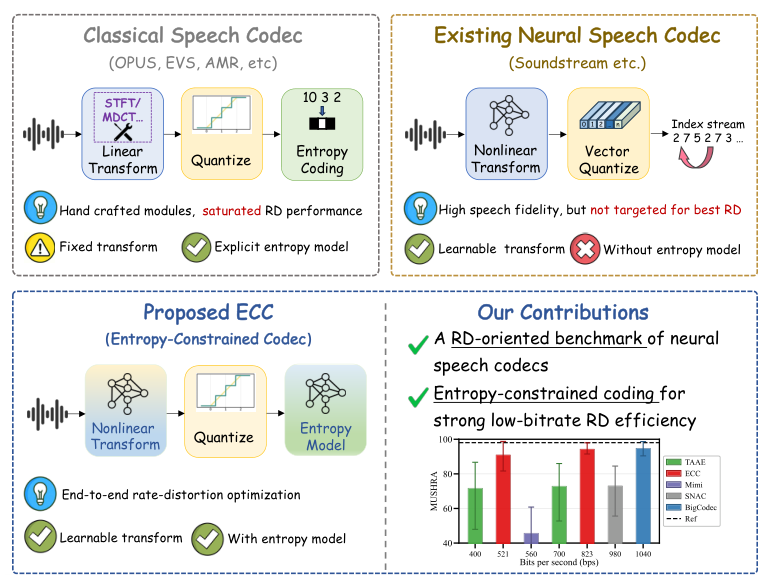
_Where ECC sits: classical codecs have an explicit entropy model but handcrafted transforms, existing neural codecs learn the transform but have no entropy model, and ECC learns both. Figure from Xu et al. (2026), Fig. 1._

## THE GAP

In the conventional pipeline, a quantizer is used to discretize continuous representations given by the encoder. This discretization is required to be able to convert it into bits. In the literature, people often construct a codebook with a preset number of representations in it. Sometimes there are multiple codebooks as in Residual Vector Quantization (RVQ). For example, consider RVQ and assume that our encoder outputs 75 frames per second. There are 8 codebooks each with 1024 representations. We need 10 bits to represent a discrete vector from each codebook. So, we need 80 bits to represent a single frame. In total, you need $80 \times 75 = 6000$ bits to encode 1 second of audio (6 kbps).

Formally, let there be $N_q$ codebooks and $K_j$ discrete vectors within the $j^{th}$ codebook. In total, you will have $R_{fixed} = \sum_{j = 1}^{N_q} \log_2{K_j}$ bits for one frame. Suppose there are $T'$ frames for a given audio, then we will need $T'R_{fixed}$ bits to represent that audio.

Note that each frame requires $R_{fixed}$ bits, irrespective of whether that is a highly repetitive frame (silences in speech for instance) or quite a surprising frame (in terms of its rarity of occurrence). Also, when you allot $\log_2 K_j$ bits for each discrete representation in the $j^{th}$ codebook, we are assuming that all codebook vectors are equally accessed by the encoder outputs. In reality, the codebook usage is non-uniform - some codebook vectors are picked far more often than others. It means that all codebook indices need not be assigned the same number of bits (frequently used indices can get shorter codes, and rarely used ones longer codes). $R_{fixed}$ is therefore an upper bound on the number of bits per frame that an ideal coder would need. The paper has a very good illustration of it (see the left half of the figure below).

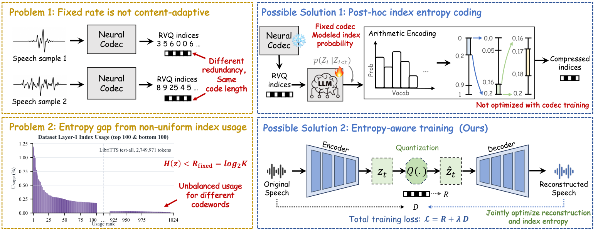
_Left: the two problems with fixed-rate RVQ indices - different content gets the same code length, and codebook usage is far from uniform (layer-1 usage on LibriTTS). Right: the two possible fixes - post-hoc entropy coding of the indices, or entropy-aware training. Figure from Xu et al. (2026), Fig. 3._

They go a bit further and ask how many extra bits ($n_e$) are spent by fixed-length coding when compared to the least number of bits needed to describe the index sequence.

$$
\begin{align}
n_e &= \sum_{t = 1}^{T'} \sum_{j = 1}^{N_q} \log_2 K_j - H(Z) \qquad \text{(Assume that the codebook index sequence across time is given by $Z$ - at each time instant, there are $N_q$ indices)} \\
    &= \sum_{t = 1}^{T'} \sum_{j = 1}^{N_q} \log_2 K_j - \sum_{t = 1}^{T'} \sum_{j = 1}^{N_q} H(Z_{t,j}) + \sum_{t = 1}^{T'} \sum_{j = 1}^{N_q} H(Z_{t,j}) - H(Z) \qquad \text{(Adding and subtracting the entropy of $Z$ had all indices $Z_{t,j}$ been independent)} \\
    &= \underbrace{\sum_{t = 1}^{T'} \sum_{j = 1}^{N_q} \left[\log_2 K_j - H(Z_{t,j})\right]}_{\Delta R_{\text{marg}}} + \underbrace{\sum_{t = 1}^{T'} \sum_{j = 1}^{N_q} H(Z_{t,j}) - H(Z)}_{\Delta R_{\text{dep}}} \label{eqnextrabits}
\end{align}
$$

Let us try to understand what these equations mean. We are essentially decomposing the number of extra bits into two components. The entropy $H(Z)$ is the least number of bits (on average) that any lossless code can expend to describe $Z$ (this holds for any uniquely decodable code, prefix-free codes included). The first line is asking how far away from this lower bound we are by making the uniform access assumption of the codebook indices. The first component is $\Delta R_{\text{marg}}$ - how many extra bits come from assuming each codebook index is uniformly accessed. The second component is $\Delta R_{\text{dep}}$ - how many extra bits come from assuming that the codebook indices are independent of each other (in reality, they are not - pitch, phonemes and the speaker's voice persist across frames, and the codebooks in RVQ refine each other's outputs). If you know the properties of entropy, you can see why, within each component, the first term is greater than or equal to the second term, i.e. both components are non-negative. If not, just take it as a fact.

The authors want to move away from preset bitrate codecs that allot the same number of bits to all sorts of frames (preset in that we are fixing the number of codebooks, the number of discrete representations in each codebook, and also the number of frames per second). One can always do post-hoc entropy coding of the codebook indices to facilitate optimized transmission of bits. But such an approach doesn't shape the latent representations of the encoder - it can only compress whatever discrete indices the quantizer already gives out. Can we make the model give out latent representations that are amenable to compression? The authors attempt to answer the question by proposing the Entropy-Constrained Codec (ECC) - an end-to-end rate-aware learnable speech compressor.

The table below summarizes recent neural speech codecs. Notice the Entropy column - ECC is the only one with an explicit learned probability model as a part of training.

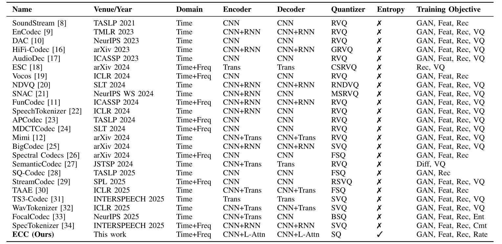
_Summary of recent neural speech codecs. The Entropy column marks whether an explicit learned probability model is a part of training or latent coding (post-hoc compression of the indices does not count). Rec = reconstruction loss, GAN = adversarial loss, Feat = feature matching, VQ = vector-quantization loss, Cmt = commitment loss, Ent = entropy-related auxiliary loss, Diff = diffusion objective, Rate = explicit rate term. Numbers in brackets are reference numbers in the paper. Table from Xu et al. (2026), Table I._

## ECC ARCHITECTURE

Before diving in, let us lay out the moving parts. ECC still follows the Encoder - Quantizer - Decoder pipeline from the prologue, but with two big changes. First, there are no codebooks. The quantizer simply rounds each number given out by the encoder to the nearest integer (this is called scalar quantization). Second, a new component called the entropy model is added. Its job is to assign a probability to every rounded number. Recall that a symbol with probability $p$ can be coded with roughly $-\log_2 p$ bits. So, the entropy model decides how many bits each rounded number costs. If it can predict a number well (assign a high probability to it), that number costs very few bits. If it cannot, that number costs a lot. The whole model is trained such that the encoder gives out numbers that the entropy model can predict well, while the decoder can still reconstruct good quality speech from them. That is what makes the codec "entropy-constrained".

> The bits are actually produced by an arithmetic coder. You hand it a sequence of symbols along with the probability of each symbol, and it gives out a bitstream whose length is very close to the sum of $-\log_2 p$ over all the symbols. The receiver runs an arithmetic decoder that recovers the symbols from the bitstream, but only if it is handed the exact same probabilities that the sender used. Keep this in mind - it dictates almost every design choice that follows! Also, note that arithmetic coding is a prefix-free coding. It means that none of the bitstrings representing the source symbols share a common-prefix. This is a coding algorithm that came with a constructive proof...
{: .prompt-info}

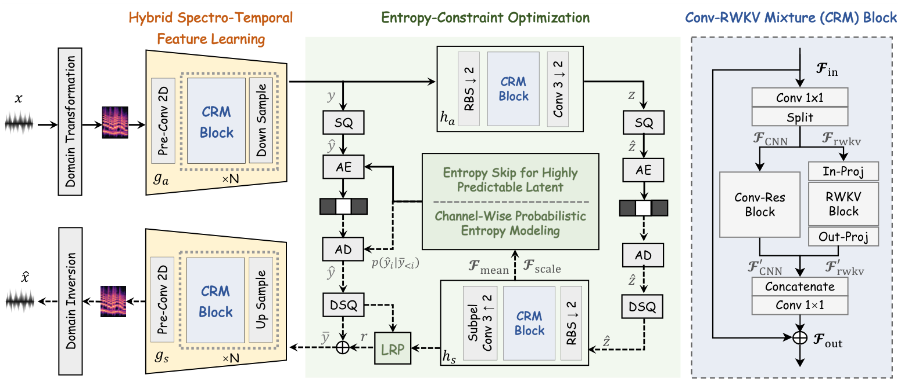
_Overview of ECC. Left: the STFT-domain encoder and decoder built from CRM blocks. Middle: the hyperprior, the channel-wise entropy model, entropy skip and LRP. Right: the CRM block. SQ/DSQ are scalar quantization/dequantization and AE/AD are the arithmetic encoder/decoder. Note that the paper writes the refined latent as ȳ, whereas this post writes it as ỹ. Figure from Xu et al. (2026), Fig. 4._

### THE ENCODER AND THE DECODER

ECC does not work on the raw waveform. The waveform $x$ is first converted to its Short-Time Fourier Transform (STFT) $X_{\text{stft}}$, a time-frequency representation of speech. Speech has a lot of structure in this domain - harmonics of the pitch show up as evenly spaced lines and formants show up as bands of energy. By handing the STFT to the encoder, the network does not have to spend its capacity learning such structure from scratch. The encoder $g_a$ (called the analysis transform in the paper) maps $X_{\text{stft}}$ to a latent $y$, which is a sequence of $T'$ frames with $C_y = 320$ channels each. The decoder $g_s$ (the synthesis transform) does the opposite. It maps the quantized (and refined, more on that later) latent $\tilde{y}$ back to an STFT, and an inverse STFT gives us the reconstructed waveform $\hat{x}$.

$$
\begin{align}
X_{\text{stft}} = \text{STFT}(x), \qquad y = g_a(X_{\text{stft}}), \qquad \hat{x} = \text{iSTFT}(g_s(\tilde{y})) \label{eqnecc}
\end{align}
$$

Both $g_a$ and $g_s$ are built by stacking Conv-RWKV Mixture (CRM) blocks along with downsampling layers (in the encoder) and upsampling layers (in the decoder). The idea behind a CRM block is that speech has dependencies at two scales. Some are local, like the transition from one phoneme to the next, which spans a few frames. Others are long-range, like the pitch range of the speaker or the rhythm of the sentence, which persist over the entire utterance. A CRM block splits its input channels into two groups. One group goes through convolutions, which are good at capturing local patterns. The other group goes through RWKV layers. RWKV is a recurrent network that can carry information across long durations, but whose cost grows only linearly with the length of the input (unlike attention in Transformers, whose cost grows quadratically). The outputs of both groups are concatenated, mixed by a $1 \times 1$ convolution, and added back to the input (a residual connection):

$$
\begin{align}
\mathcal{F}_{\text{out}} = \mathcal{F}_{\text{in}} + \mathcal{W}_{\text{fuse}}\left(\text{Concat}\left(\mathcal{H}_{\text{CNN}}(\mathcal{F}_{\text{cnn}}), \mathcal{H}_{\text{RWKV}}(\mathcal{F}_{\text{rwkv}})\right)\right) \qquad \text{($\mathcal{F}_{\text{cnn}}$ and $\mathcal{F}_{\text{rwkv}}$ are the two channel groups of $\mathcal{F}_{\text{in}}$)} \label{eqncrm}
\end{align}
$$

> Since there are no codebooks, ECC is free of the usual headaches of vector quantization - codebook vectors that never get used (codebook collapse), and the extra losses needed to keep the encoder outputs close to the codebook vectors (commitment losses). The job of making the bits cheap is handed over entirely to the entropy model. In earlier works like FocalCodec, there was an auxiliary entropy term in the loss. Though scalar quantization was used there, they still had codebook collapse prevention loss and commitment loss. But the way entropy will be used here is much different from that work. If you are interested, you can check out FocalCodec which is also an interesting paper.
{: .prompt-tip}

### THE ENTROPY MODEL

Now to the heart of ECC. Let us first decide what kind of probability the entropy model assigns. Each number $y_n$ in the latent (the index $n$ runs over all frames and channels) is modelled as a Gaussian with mean $\mu_n$ and standard deviation $\sigma_n$. Both are predicted by the entropy model (we will see how shortly). Instead of rounding $y_n$ directly, ECC rounds the residual $d_n = y_n - \mu_n$, i.e. what is left after removing the prediction from $y_n$:

$$
\begin{align}
d_n = y_n - \mu_n, \qquad \hat{d}_n = \text{round}(d_n), \qquad \hat{y}_n = \mu_n + \hat{d}_n \label{eqnresidual}
\end{align}
$$

Since $\hat{d}_n$ is an integer, we need the probability of an integer, not a density. An integer $k$ collects all values of $d_n$ that round to it, i.e. the interval $[k - \frac{1}{2}, k + \frac{1}{2})$. So, the probability of $\hat{d}_n = k$ is the area under the Gaussian over that interval:

$$
\begin{align}
p_n(k) &= \int_{k - \frac{1}{2}}^{k + \frac{1}{2}} \mathcal{N}(t; 0, \sigma_n^2) \, dt = \Phi\left(\frac{k + \frac{1}{2}}{\sigma_n}\right) - \Phi\left(\frac{k - \frac{1}{2}}{\sigma_n}\right) \qquad \text{($\Phi$ is the standard normal CDF)} \label{eqnbin}\\
\text{bits}_n &= -\log_2 p_n(\hat{d}_n) \label{eqnbits}
\end{align}
$$

Now, where do $\mu_n$ and $\sigma_n$ come from? Remember the rule of the arithmetic coder - the receiver must be able to compute the exact same $\mu_n$ and $\sigma_n$ as the sender. So, they cannot be computed from $y$ directly, because the receiver doesn't have $y$ (that is what we are trying to send in the first place!). ECC relies on two sources of information that the receiver will have.

**Hyperprior (side information).** A small network $h_a$ looks at $y$ and summarizes it into a much smaller latent $z$ (fewer frames and 192 channels). $z$ is rounded to $\hat{z}$ and sent first, with its own simple probability model (a factorized prior - each channel of $\hat{z}$ has a learned distribution of its own that does not depend on the input). On both sides, another network $h_s$ turns $\hat{z}$ into features $$\mathcal{F}_{\text{mean}}$$ and $$\mathcal{F}_{\text{scale}}$$ that hint at the means and scales of $y$.

$$
\begin{align}
z = h_a(y), \qquad \hat{z} = \text{round}(z), \qquad \mathcal{F}_{\text{mean}}, \mathcal{F}_{\text{scale}} = h_s(\hat{z}) \label{eqnhyper}
\end{align}
$$

**Channel-wise context.** The 320 channels of $y$ are split into $S = 5$ slices of 64 channels each, which are coded one after the other. Slice 1 is predicted from the hyperprior features alone. Slice 2 is predicted from the hyperprior features and slice 1 (which the receiver would have decoded by then). Slice 3 uses slices 1 and 2, and so on. Each later slice gets to see more context, so it can be predicted better and hence costs fewer bits. Inside the networks that predict the means and scales ($$\mathcal{G}_{\text{mean}}$$ and $$\mathcal{G}_{\text{scale}}$$), RWKV layers model the dependencies across time once again.

$$
\begin{align}
\mu_i = \mathcal{G}_{\text{mean}}\left(\text{Concat}(\mathcal{F}_{\text{mean}}, \tilde{y}_{<i})\right), \qquad \sigma_i = \mathcal{G}_{\text{scale}}\left(\text{Concat}(\mathcal{F}_{\text{scale}}, \tilde{y}_{<i})\right) \qquad \text{($\tilde{y}_{<i}$ denotes the slices decoded before slice $i$)} \label{eqnslice}
\end{align}
$$

**Latent Residual Prediction (LRP).** Rounding throws away information - the decoded slice differs from $y_i$ by a rounding error. After decoding slice $i$ (call it $$\bar{y}_i$$), a small network $$\mathcal{G}_{\text{LRP}}$$ tries to guess that error from the decoded slice, the hyperprior features and the previous slices, and adds its guess $r_i$ back. Since everything it uses is available at the receiver, this correction costs zero bits! The refined slice $$\tilde{y}_i$$ is what the decoder $g_s$ consumes, and also what the later slices use as context.

$$
\begin{align}
r_i = \mathcal{G}_{\text{LRP}}\left(\text{Concat}(\bar{y}_i, \mathcal{F}_{\text{mean}}, \tilde{y}_{<i})\right), \qquad \tilde{y}_i = \bar{y}_i + r_i \label{eqnlrp}
\end{align}
$$

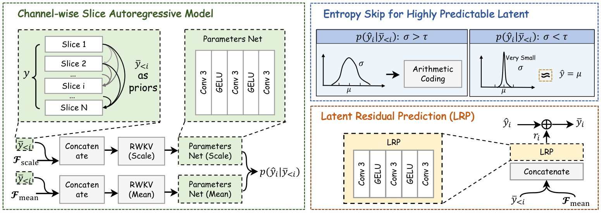
_Left: the channel-wise slice model - previously decoded slices are concatenated with the hyperprior features, passed through RWKV and a small convolutional network to predict the mean and scale of the next slice. Top right: entropy skip (next section). Bottom right: LRP. As before, the paper's ȳ is the refined slice (ỹ in this post). Figure from Xu et al. (2026), Fig. 5._

### ENTROPY SKIP

When does $\text{round}(d) = 0$? For $d \sim \mathcal{N}(0, \sigma^2)$:

$$
\begin{align}
P(\text{round}(d) = 0) = P\left(-\frac{1}{2} \leq d < \frac{1}{2}\right) = 2\Phi\left(\frac{1}{2\sigma}\right) - 1 \label{eqnzeroprob}
\end{align}
$$

If $\sigma$ is too small, then the probability is close to $1$. This means that most of $y_n$ is predictable from its mean $\mu_n$. In that case, should we expend bits to send this residual? Can we not retrieve info about this $y_n$ just from the hyperprior by predicting $\mu_n$? This is the essence of entropy skip! If $\sigma_n$ is too small (the threshold set in the paper is $0.12$), then we skip coding that residual on the transmitter side. We set $y_n$ as $\mu_n$ in the transmitter side as later slices are predicted from previous slices. On the receiver side, we will anyways be predicting $\sigma_n$ using the same network as in the transmitter. We again apply entropy skip here based on the shared threshold between transmitter and receiver. The latter uses the same decoded $y_n$ as the former for further processing. 

The beautiful part is how the receiver knows which residuals were skipped. The decision depends only on $\sigma_n$, which the receiver computes by itself (recall the rule of the arithmetic coder!). So, the sender and the receiver make the exact same skip decisions independently, and no extra bits are needed to tell the receiver which positions were skipped. Had the rule looked at $d_n$ itself (e.g. "skip whenever $\hat{d}_n = 0$", which the paper calls oracle skip), the receiver could never reproduce the decision, since it doesn't know $d_n$. That is why the paper uses oracle skip only as a diagnostic, and not as a part of the codec.

### TRAINING

We want to train the encoder, the decoder and the entropy model together such that the reconstructed speech sounds good (low distortion $D$) and the bitstream is short (low rate $R$). These two goals fight with each other - fewer bits generally means worse quality. So, ECC minimizes a weighted sum of the two, $R + \lambda D$. A large $\lambda$ cares more about quality and ends up spending more bits. A small $\lambda$ does the opposite. Each value of $\lambda$ gives one trained model that sits at one point on the rate-distortion curve. To operate at a different bitrate, you use a different model.

There is a problem though. The rate is the sum of $-\log_2 p_n(\hat{d}_n)$, and $\hat{d}_n$ comes from rounding. Rounding is a staircase function - its gradient is zero almost everywhere (and undefined at the jumps). Backpropagation through it will tell the encoder nothing. ECC uses two different workarounds, one for each goal:

- **For the rate:** rounding is replaced by adding uniform noise, $\tilde{d}_n = d_n + u_n$ with $u_n \sim \mathcal{U}(-\frac{1}{2}, \frac{1}{2})$. This is differentiable with respect to $d_n$. Why uniform noise? Rounding changes a number by at most half, and the rounding error behaves a lot like uniform noise on $[-\frac{1}{2}, \frac{1}{2})$. Also, the density of $d_n + u_n$ is exactly the Gaussian convolved with the uniform, which at integers equals the probability in $\ref{eqnbin}$. So, the training estimate of bits closely tracks the real bits.
- **For the reconstruction:** the decoder should see exactly what it will see at inference, i.e. truly rounded values. So, the forward pass uses real rounding, while the backward pass pretends that rounding was the identity function and passes the gradients straight through. This is called the straight-through estimator.

The noise trick is not perfect though. When $\sigma_n$ is tiny, the true residual is almost surely $0$ and costs almost nothing. But the noisy value $\tilde{d}_n$ is spread over $[-\frac{1}{2}, \frac{1}{2})$, and near the edges of that interval, the estimated bits shoot up. This makes the estimated rate of confident elements both noisy and inflated. Entropy skip fixes this - skipped elements are simply removed from the rate loss (they emit zero bits after all), so the model is not penalized for bits that will never be sent. The paper shows that this shrinks the gap between the rate estimated during training and the rate measured with real rounding.

$$
\begin{align}
\mathcal{L}_{\text{rate}}^{y} &= -\sum_{n} (1 - s_n) \log_2 p_n(\tilde{d}_n), \qquad s_n = \mathbb{I}(\sigma_n \leq \tau_\sigma) \qquad \text{($s_n = 1$ for skipped elements)} \label{eqnyrate}\\
\mathcal{L}_{\text{total}} &= \mathcal{L}_{\text{rate}}^{y} + \mathcal{L}_{\text{rate}}^{z} + \lambda_{rd} D \qquad \text{($\mathcal{L}_{\text{rate}}^{z}$ is the rate of the side information $\hat{z}$)} \label{eqntotal}
\end{align}
$$

The distortion $D$ is not a single loss, but a mix of four:

- **Multi-scale mel loss:** the mel spectrograms of $x$ and $\hat{x}$ are compared at several window sizes (from $2^5$ to $2^{11}$ samples). Short windows catch errors in timing and long windows catch errors in frequency, so the reconstruction has to be right on both fronts.
- **Adversarial loss:** discriminators are trained to tell real speech from reconstructed speech, and the codec is penalized whenever it gets caught. One discriminator looks at periodic structure in the waveform (pitch), and the other looks at the spectra at multiple resolutions. This pushes the output to sound natural, and not just match on average (a codec trained only on the mel loss tends to produce muffled speech).
- **Feature matching loss:** the internal features of the discriminators should be similar for $x$ and $\hat{x}$. This stabilizes the adversarial training.
- **Waveform L1 loss:** $\lVert x - \hat{x} \rVert_1$, used only in the second stage of training (below) to improve objective metrics like PESQ.

$$
\begin{align}
D = \lambda_{\text{mel}} \mathcal{L}_{\text{mel}} + \lambda_{\text{adv}} \mathcal{L}_{\text{adv}} + \lambda_{\text{fm}} \mathcal{L}_{\text{FM}} + \lambda_{\text{wav}} \mathcal{L}_{\text{wav}} \label{eqndistortion}
\end{align}
$$

Training happens in two stages. In the first stage, a model is trained at a high bitrate ($\lambda_{rd} = 10$), without entropy skip and without the waveform loss. The model first learns to reconstruct speech well, without much pressure on the bits. In the second stage, this model is fine-tuned towards lower and lower bitrates by reducing $\lambda_{rd}$, one model per target bitrate. Entropy skip and the waveform loss are switched on here. It is a bit like learning to write well first, and only then learning to write concisely.

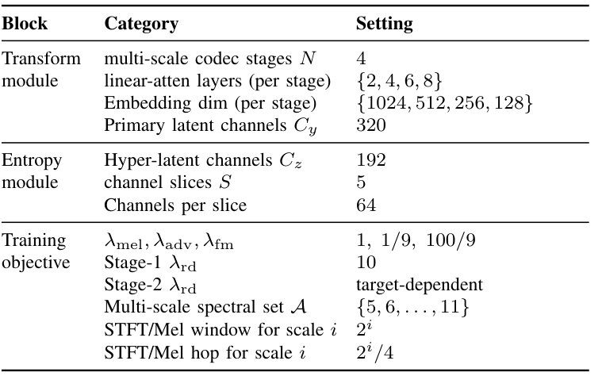
_Key hyperparameters of ECC. Table from Xu et al. (2026), Table II._

### INFERENCE

Once trained, here is what happens when you speak into an ECC-powered phone. On the sender side:

1. The waveform goes through the STFT and the encoder $g_a$ to give the latent $y$.
2. $h_a$ summarizes $y$ into $z$. It is rounded to $\hat{z}$, and the arithmetic coder writes $\hat{z}$ into the bitstream using the factorized prior. This is the side information.
3. $h_s$ turns $$\hat{z}$$ into $$\mathcal{F}_{\text{mean}}$$ and $$\mathcal{F}_{\text{scale}}$$.
4. For each slice $i = 1, 2, \ldots, 5$:
    - Predict $\mu_i$ and $\sigma_i$ from the hyperprior features and the previously refined slices.
    - For every element with $\sigma_n \leq \tau_\sigma$, skip it. For every other element, round the residual $y_n - \mu_n$ and let the arithmetic coder write it into the bitstream using the probabilities from $\ref{eqnbin}$.
    - Form the decoded slice $\bar{y}_i$ and refine it with LRP to get $\tilde{y}_i$.
5. Send the bitstream - the side information followed by the five slices.

Notice something odd in step 4? The sender computes the decoded and refined slices, which is really the receiver's job. It has to, because the context for slice $i + 1$ is built from the refined slices, exactly as the receiver will see them. The sender runs a copy of the receiver's computations to stay in sync with it. On the receiver side:

1. The arithmetic decoder reads $\hat{z}$ using the same factorized prior.
2. $h_s$ turns $\hat{z}$ into the same $$\mathcal{F}_{\text{mean}}$$ and $$\mathcal{F}_{\text{scale}}$$ that the sender had.
3. For each slice $i = 1, 2, \ldots, 5$:
    - Predict the same $\mu_i$ and $\sigma_i$ as the sender (same networks, same inputs).
    - Mark every element with $\sigma_n \leq \tau_\sigma$ as skipped, and set its residual to $0$. For every other element, the arithmetic decoder reads the residual from the bitstream.
    - Form $\bar{y}_i = \mu_i + \bar{d}_i$ and refine it with LRP to get $\tilde{y}_i$.
4. The decoder $g_s$ turns $\tilde{y}$ into an STFT, and the inverse STFT gives the waveform $\hat{x}$.

The number of bits sent is whatever the arithmetic coder produced, and that depends on the content. Silences and steady vowels are easy to predict, so they are cheap. Fast transitions and surprising sounds cost more. This is exactly what the preset bitrate codecs from the previous section could not do!

## RESULTS

The paper compares ECC against classical codecs (Opus, EVS, AMR-WB) and a long list of neural codecs (SoundStream, EnCodec, DAC, SNAC, FunCodec, SpeechTokenizer, Mimi, BigCodec, SemantiCodec and TAAE). ECC is trained on LibriTTS (English audiobooks) and tested on LibriTTS and VCTK (English, but different speakers and recording conditions). Since ECC produces a variable number of bits, its reported bitrate is the actual average size of its bitstream (side information included), and not a nominal number. Let us go through the points that matter the most.

### QUALITY VERSUS BITS

The quality of reconstructed speech is measured with objective metrics: ViSQOL and PESQ (perceptual quality), STOI and ESTOI (intelligibility), the word error rate of a speech recognizer (WER), and speaker similarity (SPK SIM). For each metric, quality is plotted against bitrate, giving one rate-distortion curve per codec. A curve that sits higher and further to the left is better - more quality for fewer bits.

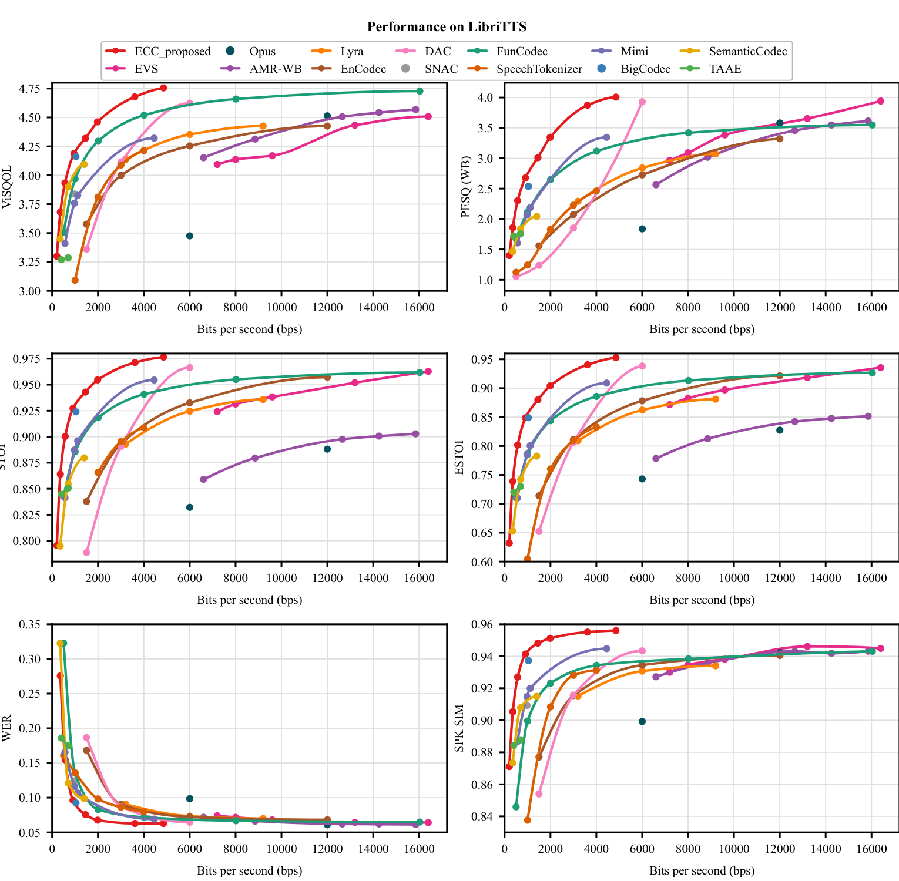
_Rate-distortion curves on LibriTTS for all the objective metrics (lower is better for WER, higher is better for the rest). ECC is the red curve on the far left. Figure from Xu et al. (2026), Fig. 6._

ECC's curve (in red) rises the fastest on almost every metric. It reaches quality that the other codecs reach only at two or more times the bitrate. Note that ECC's curve stops at about 5 kbps - it is designed for the low bitrate regime. To summarize such curves in a single number, the paper uses BD-rate.

> BD-rate (Bjøntegaard delta rate) compares two rate-distortion curves over the range of quality where both exist. It gives the average percentage change in bitrate needed to reach the same quality as the reference codec. A BD-rate of $-40\%$ means that, on average, you need $40\%$ fewer bits for the same quality.
{: .prompt-info}

With FunCodec as the reference, ECC needs about $44\%$ (LibriTTS) and $36\%$ (VCTK) fewer bits for the same ViSQOL, and about $69\%$ (LibriTTS) and $83\%$ (VCTK) fewer bits for the same PESQ. It also gives the best BD-rate for speaker similarity on both datasets. ECC is not the winner everywhere though. On WER, it is second best on LibriTTS, and a few codecs beat it on VCTK. On VCTK's PESQ, the classical EVS codec does better. The full comparison is given below - the left half shows the BD-rate (lower is better), and the right half shows the average quality gain at the same bitrate (BD-metric).

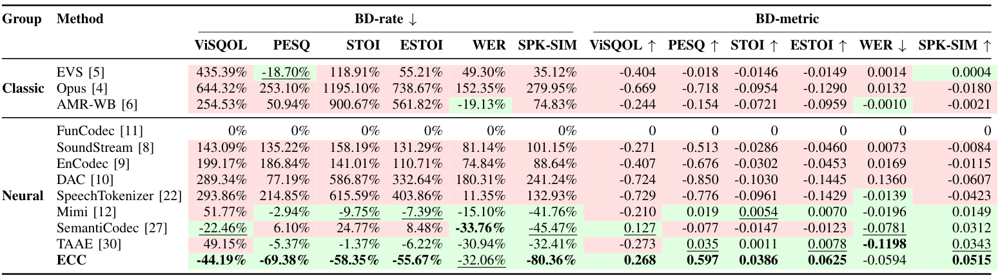
_BD comparison relative to FunCodec on LibriTTS test-all. Green and red backgrounds mark values better and worse than FunCodec. Bold marks the best value in each column and underline the second best. Numbers in brackets are reference numbers in the paper. Table from Xu et al. (2026), Table III._

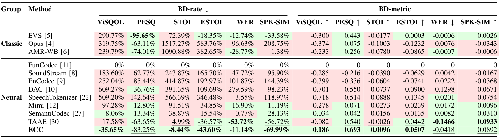
_BD comparison relative to FunCodec on VCTK, laid out as in the previous table. Table from Xu et al. (2026), Table IV._

### WHAT DO LISTENERS SAY?

Objective metrics are only a proxy, so the paper also runs a MUSHRA listening test, where listeners rate each sample from $0$ to $100$ while comparing it against the original (the dashed line).

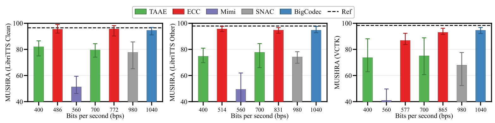
_MUSHRA scores in the low bitrate regime on LibriTTS test-clean, LibriTTS test-other and VCTK. ECC is shown in red. Figure from Xu et al. (2026), Fig. 8._

On LibriTTS, ECC at under $500$ bits per second scores about the same as BigCodec at $1040$ bits per second - roughly half the bits for the same perceived quality. It is also far ahead of TAAE, Mimi and SNAC at comparable bitrates. On VCTK (unseen speakers and recording conditions), ECC needs a little more (about $865$ bits per second) to come close to BigCodec.

### ISN'T POST-HOC ENTROPY CODING ENOUGH?

Recall from THE GAP that one could simply entropy-code the indices of an existing RVQ codec after training. The paper tests this directly on FunCodec - from simple frequency counts all the way up to a $100$M parameter language model that predicts the next index.

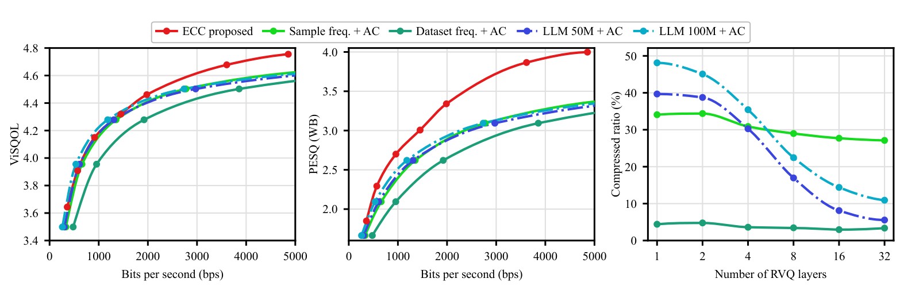
_Left and middle: ECC against FunCodec with its indices entropy-coded after training (AC = arithmetic coding). Right: how much each post-hoc coder compresses the indices of each RVQ stage. Figure from Xu et al. (2026), Fig. 10._

Post-hoc coding does save bits, but only by squeezing the same indices - the quality at a given number of codebooks does not change at all. The savings also shrink in the later RVQ stages. The best post-hoc coder compresses the indices of the first stage by about $48\%$, but only about $11\%$ by the $32^{nd}$ stage. The later stages carry the fine residual details, which look a lot like noise and are hard to predict. ECC, which shapes the latent itself, ends up well above all the post-hoc variants, especially on PESQ. This is the strongest evidence for the central claim of the paper - the bits have to be a part of training, not something counted afterwards.

### HOW MUCH DOES ENTROPY SKIP HELP?

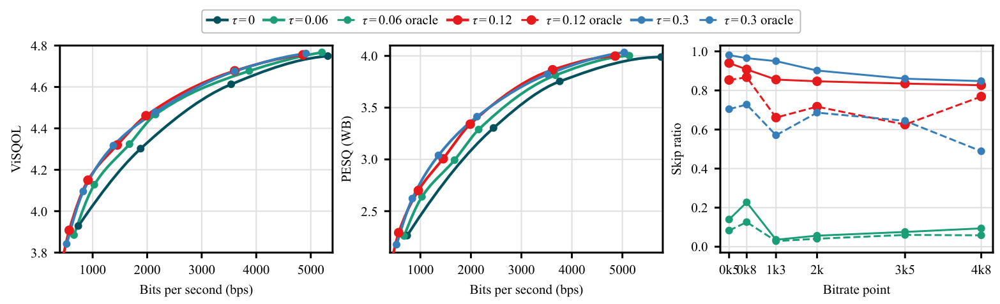
_Left and middle: rate-distortion curves for different skip thresholds τ (τ = 0 means no skipping). Right: the fraction of latent elements that get skipped, for the normal rule (solid) and the oracle rule (dashed). Figure from Xu et al. (2026), Fig. 11._

Any non-zero threshold improves over no skipping at all, and $\tau_\sigma = 0.12$ gets most of the gain. The plot on the right is the surprising part. At $\tau_\sigma = 0.12$, about $82$ to $94\%$ of all latent elements are skipped! Most of the latent is never sent, and the receiver relies on the predicted means for it.

There is another subtle point here. The dashed lines show how many of the skipped residuals were actually zero after rounding. If $\sigma_n$ were a faithful standard deviation, a skipped residual would be non-zero only about $3$ times in $100,000$ at $\tau_\sigma = 0.12$, and the solid and dashed lines would coincide. Instead, the gap is as large as $20\%$ of the elements at some bitrates. This suggests that, after training with entropy skip, a small $\sigma_n$ no longer just means "I am confident". The model seems to also use it as a switch for "this element is not worth any bits" - a skipped element costs nothing, and the decoder and LRP are trained to live with whatever is lost. The paper also notes that restoring those non-zero residuals (oracle skip) does not necessarily help, since the rest of the model was trained with the normal skip rule.

### WHICH PARTS MATTER?

The ablation study swaps out one design choice at a time. The variants are named by their backbone (CRM or plain convolutions), their entropy model (CW for channel-wise context with LRP, HP for the hyperprior alone), and the number of RWKV layers in the entropy model (l0 or l4).

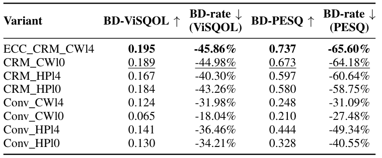
_BD ablation results of the variants on LibriTTS test-all. Bold marks the best value and underline the second best. Table from Xu et al. (2026), Table V._

Looking at the ViSQOL BD-rate:

- **Backbone:** replacing the CRM blocks with plain convolutions hurts the most ($-46\%$ becomes $-32\%$). Long-range modelling with RWKV matters a lot.
- **Entropy model:** with the CRM backbone, dropping the channel-wise context and LRP (keeping only the hyperprior) gives $-40\%$ instead of $-46\%$. The previously decoded slices carry information that the hyperprior alone does not.
- **RWKV in the entropy model:** removing it costs only about $1\%$. Most of the gain comes from the backbone and the channel-wise structure.

### DOES IT GENERALIZE?

ECC is trained only on English, yet on Mandarin speech (AISHELL-3) it keeps the same advantage at low bitrates in both the objective metrics and the listening test. This makes sense - ECC is not a language model. It is learning how to compress acoustic structure (pitch, formants, the voice of the speaker), which is shared across languages.

### THE COST

All of this does not come for free. ECC has about $151$M parameters and needs about $17$ GMACs (billion multiply-accumulate operations) per second of audio. FunCodec, its reference, has $4.5$M parameters and needs about $2$ GMACs per second. ECC's compute is comparable to SpeechTokenizer, and it is lighter than DAC, BigCodec, TAAE and SemantiCodec. Also, the slices are coded one after the other, which adds sequential steps and latency - an important concern for real-time calls.

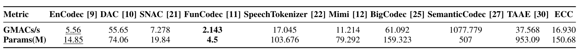
_Complexity of the neural network parts of each codec, in billions of multiply-accumulate operations per second of audio (GMACs/s) and millions of parameters. Bold marks the lowest value and underline the second lowest. Table from Xu et al. (2026), Table VI._

## EPILOGUE

Through ECC, we can see the importance of having the model learn to give out representations that are amenable to compression while maintaining reasonable fidelity upon reconstruction. Going back to the prologue, fewer bits for the same quality means that more people can share the same auctioned band.

But ECC is not streamable as such - it needs the entire utterance before it can encode anything, which rules out real-time calls. For instance, it uses group normalization, whose statistics are computed over the entire utterance at once. To counter this, the same group came up with a streamable version of essentially the same architecture in a follow-up paper called [StreamLSC](https://arxiv.org/abs/2610.21998). The audio is processed in frames of 80 ms, and three changes make sure that nothing depends on future frames. Group normalization is replaced with intra-frame layer normalization (statistics are computed within the current frame alone). The last few values of each frame are cached so that the causal convolutions of the next frame can continue exactly where they left off. RWKV, which only looks at the past anyway, is run in its recurrent mode, carrying a state from one frame to the next. With all three, processing the audio frame by frame gives the same output as processing the entire utterance, so the model can be trained offline and deployed in a streaming fashion without any change. That work shows promise of real-time entropy-constrained codecs (its real-time factor is about $0.05$ on a GPU, i.e. one second of audio takes about $50$ ms to process, though this is still about $10$ times slower than FunCodec), but the analysis in that paper is a bit limited. So, I am keeping my discussion of it very short.

## REFERENCES

> Xu, J., Cheng, Z., Zhang, F., Liu, Y., Song, L., & Zhang, W. (2026). *Benchmarking Neural Speech Compression from a Rate–Distortion Perspective*. arXiv:2606.11631.

> Liu, Y., Xu, J., Zhang, F., Cheng, Z., & Song, L. (2026). *Frame-Wise Streaming for Efficient Learned Speech Compression*. arXiv:2610.21998.

All figures and tables in this post are taken from Xu et al. (2026) and are credited in their captions.

## AI USAGE DISCLOSURE

Unlike my other blog posts, this one was a hybrid writing effort between Claude and me. I wrote the prologue, the gap and the epilogue myself, and Claude corrected their grammar and sentence structure, and fact-checked them. As I was running short on time due to other commitments, I asked Claude to draft the architecture and results sections by referring to the paper and my previous blog posts, and I then edited the draft it generated.
